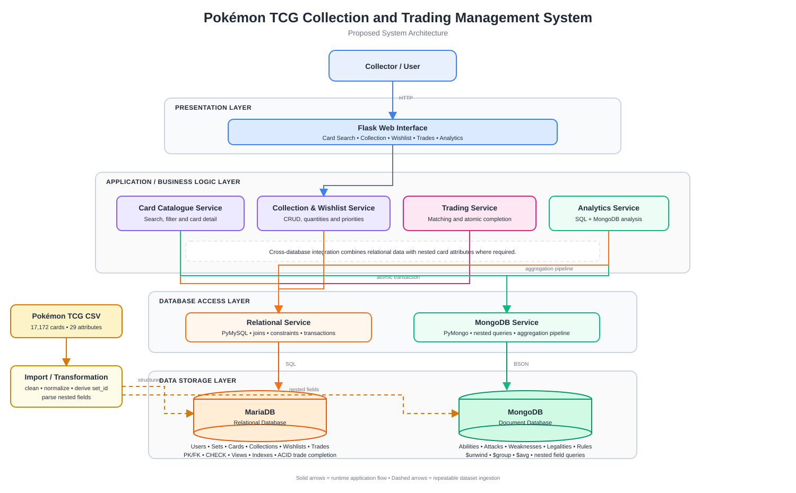
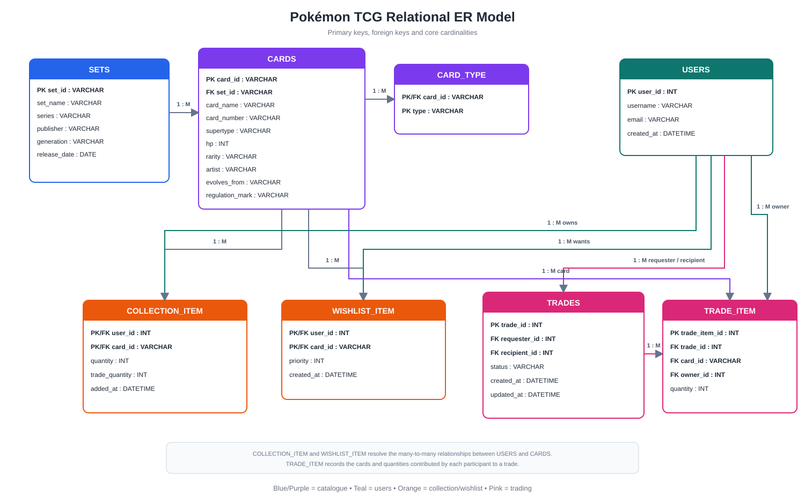

# INF2003 Pokémon TCG Collection and Trading Management System

Team 40 project for **INF2003 Database Systems**.

The application combines a relational database and a document database to support Pokémon TCG card discovery, personal collection management, wishlists, trading workflows, and analytics.

## System architecture



The application is organised into four layers:

- **Presentation layer:** Flask routes and templates for card search, collection, wishlist, trades, trade matching, and analytics.
- **Application layer:** catalogue, collection/wishlist, trading, and analytics services.
- **Database access layer:** PyMySQL for MariaDB and PyMongo for MongoDB.
- **Data storage layer:** MariaDB for structured transactional data and MongoDB for flexible nested card attributes and aggregation workloads.

The import pipeline transforms the source CSV into both database models. Structured catalogue fields are normalised into MariaDB, while variable nested fields such as attacks, abilities, weaknesses, resistances, legalities, and rules are stored as MongoDB documents.

Editable diagrams are available in `docs/`.

## Database design



### MariaDB

The relational model contains eight main entities:

```text
USERS
SETS
CARDS
CARD_TYPE
COLLECTION_ITEM
WISHLIST_ITEM
TRADES
TRADE_ITEM
```

The schema includes:

- primary and foreign keys
- composite keys for junction tables
- UNIQUE constraints
- CHECK constraints
- indexes on frequently queried attributes
- the `user_collection_summary` view
- transactional trade completion with validation and rollback

### MongoDB

MongoDB stores one `card_details` document per card with nested and optional attributes such as:

```text
abilities[]
attacks[]
weaknesses[]
resistances[]
retreat_cost[]
legalities{}
rules[]
ancient_trait
evolves_to[]
national_pokedex_numbers[]
```

MongoDB is used for both nested-field queries and aggregation pipelines, including attack/ability keyword search, high-damage attack search, weakness distribution, legality analysis, and average attack count by Pokémon type.

## Core functionality

### Card catalogue

- search by card name
- filter by set, type, rarity, and minimum HP
- combine MariaDB catalogue fields with MongoDB nested card details

### Collection and wishlist

- add, update, and remove cards
- track owned quantity
- track tradeable quantity
- assign wishlist priority

### Trading

- create trades between two users
- record cards offered by each participant
- find wishlist cards currently available from other users
- find reciprocal matches where both users own cards wanted by the other
- complete trades atomically using a database transaction

### Analytics

- user collection summaries
- set-completion percentage
- weakness distribution
- legality distribution
- average number of attacks by type
- nested attack/ability keyword search
- attack-damage threshold search

## Advanced relational queries

Open **SQL Demo** to inspect the actual supplier matching, reciprocal matching,
set completion and unavailable-wishlist queries used by the application.
The SQL, application pages and EXPLAIN script share the same definitions.


The project includes several multi-table queries. The main trade-matching query joins:

```text
WISHLIST_ITEM
CARDS
SETS
COLLECTION_ITEM
USERS
```

A reciprocal matching query compares both users' wishlists and tradeable collections. Set-completion analysis uses joins, aggregation, `COUNT(DISTINCT ...)`, `GROUP BY`, and a subquery.

Example queries are available in:

```text
schema/demo_queries.sql
```

## Dataset

The project uses **Pokemon TCG All Cards 1999-2023**.

The source CSV used for development contains:

```text
17,172 card records
29 source attributes
```

Place the CSV at:

```text
data/pokemon-tcg-data-master 1999-2023.csv
```

The raw dataset is not versioned in this repository. The import pipeline reconstructs the project databases from the source file.

## Prerequisites

Install:

- Python 3.11+
- MariaDB Server
- MongoDB Community Server

## Environment setup

### Windows PowerShell

```powershell
git clone https://github.com/NixonLeeDS/INF2003-Pokemon-TCG.git
cd INF2003-Pokemon-TCG

py -m venv .venv
.venv\Scripts\Activate.ps1

pip install -r requirements.txt
Copy-Item .env.example .env
```

### macOS / Linux

```bash
git clone https://github.com/NixonLeeDS/INF2003-Pokemon-TCG.git
cd INF2003-Pokemon-TCG

python3 -m venv .venv
source .venv/bin/activate

pip install -r requirements.txt
cp .env.example .env
```

Edit `.env` and set the local MariaDB connection details.

Default database names:

```text
MariaDB: inf2003_pokemon
MongoDB: inf2003_pokemon
```

## Initialise the databases

Make sure MariaDB and MongoDB are running.

Then run:

```bash
python -m scripts.bootstrap
```

**Bootstrap recreates all eight relational tables and removes their existing data. Use a disposable demonstration database.**

The bootstrap process:

1. recreates the MariaDB project schema
2. loads the relational card catalogue
3. loads nested card documents into MongoDB
4. creates MongoDB indexes
5. creates demonstration users
6. seeds collection and wishlist overlap for trade-matching tests

## Verify the setup

```bash
python -m scripts.verify_setup
```

Expected headline counts:

```text
MariaDB cards        : 17172
MongoDB card_details : 17172
```

## Run the application

```bash
python app.py
```

Open:

```text
http://127.0.0.1:5000
```

## Recommended demonstration flow

1. Search the card catalogue and open a card detail page.
2. Select a user and update the user's collection.
3. Mark selected copies as tradeable.
4. Add cards to another user's wishlist.
5. Open **Trade Matches** to demonstrate the five-table join.
6. Demonstrate reciprocal trade matching.
7. Create a trade, accept as the recipient, then complete as either participant.
8. Verify that both collections update atomically.
9. Open **Analytics** to demonstrate the MongoDB aggregation queries.

## Repository structure

```text
INF2003-Pokemon-TCG/
├── app.py
├── config.py
├── db.py
├── requirements.txt
├── .env.example
├── data/
│   └── README.md
├── docs/
│   ├── ARCHITECTURE.md
│   ├── DESIGN_NOTES.md
│   ├── ERD.drawio
│   ├── ERD.svg
│   ├── QUERY_CATALOG.md
│   ├── System_Architecture.drawio
│   └── System_Architecture.svg
├── schema/
│   ├── create_schema.sql
│   └── demo_queries.sql
├── scripts/
│   ├── bootstrap.py
│   ├── import_data.py
│   ├── init_db.py
│   ├── seed_demo_data.py
│   └── verify_setup.py
├── services/
│   ├── relational.py
│   └── mongo.py
├── static/
│   └── style.css
└── templates/
```

## Technical documentation

- [Architecture](docs/ARCHITECTURE.md)
- [Database design notes](docs/DESIGN_NOTES.md)
- [Query catalog](docs/QUERY_CATALOG.md)
- [ER diagram preview](docs/ERD.svg)
- [Editable ER diagram](docs/ERD.drawio)
- [Editable system architecture diagram](docs/System_Architecture.drawio)

## Verification and submission evidence

```bash
python -m unittest discover -s tests -v
python -m compileall -q app.py config.py db.py services scripts tests
python -m scripts.explain_queries --user-id 1
```

The tests use mocked database connections and check input rules, all trade-state/
actor combinations, rollback paths, CSRF protection, and template compilation.
Query-result tests also execute the advanced SQL against a small in-memory SQLite
fixture to check supplier availability, reciprocal matches, unique-card completion
and anti-query semantics. They do not establish
MariaDB execution plans or live database concurrency correctness.

Open **Status** (`/health`) to check each store independently; outages return HTTP
503. The deterministic seed prints the actual participant IDs and a valid trade
pair, avoiding assumptions about auto-increment IDs.

See [submission checklist](docs/SUBMISSION_CHECKLIST.md) for live transaction,
performance, aggregation, and screenshot evidence still to collect.
See [transaction rules](docs/TRANSACTIONS.md) for state transitions and locking.

This is a local multi-user demonstration, with explicit user selection rather
than authentication. Participant checks enforce workflow roles for the selected
user; they do not prove the caller's identity. Keep it bound to localhost.
Set a random `FLASK_SECRET_KEY` in `.env`; debug mode defaults to off. POST forms
use session CSRF tokens. Environment variants, private keys, logs and raw datasets
are ignored; `.env.example` is the tracked configuration template.
